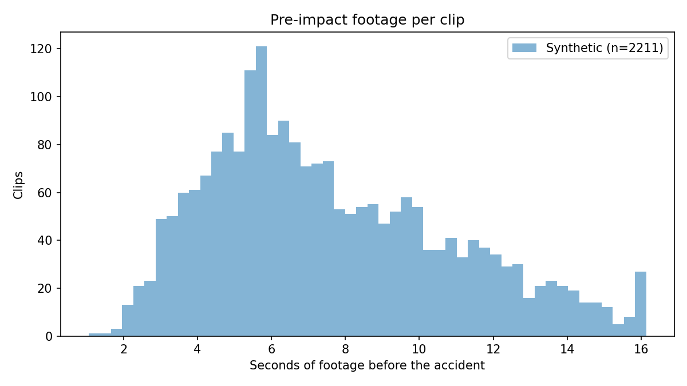

# Dataset audit — pre-impact footage and false-alarm budget

_Columns in metadata-synthetic.csv: rgb_path, annotations_path, type, accident_time, accident_frame, center_x, center_y, x1, y1, x2, y2, map, weather, camera_position, no_frames, duration, height, width, annotations_start_offset_

## Synthetic (2211 clips)

- fps source: no_frames / duration
- Clips with an accident label: 2211 / 2211 -> clips with NO accident: 0

**Collision types**

| type | clips | share |
|---|---|---|
| rear-end | 794 | 35.9% |
| head-on | 588 | 26.6% |
| sideswipe | 405 | 18.3% |
| t-bone | 358 | 16.2% |
| single | 66 | 3.0% |

**map**

| map | clips |
|---|---|
| Town05 | 558 |
| Town03 | 396 |
| Town04 | 384 |
| Town06 | 361 |
| Town07 | 328 |
| Town10HD | 184 |

**weather**

| weather | clips |
|---|---|
| clear | 515 |
| sunset | 461 |
| night | 449 |
| wet | 444 |
| rain | 342 |

**camera_position**

| camera_position | clips |
|---|---|
| 13 | 45 |
| 18 | 42 |
| 5 | 41 |
| 2 | 40 |
| 1 | 40 |
| 40 | 40 |
| 10 | 40 |
| 22 | 40 |
| 3 | 40 |
| 17 | 40 |
| 14 | 40 |
| 34 | 40 |
| 45 | 39 |
| 37 | 39 |
| 19 | 39 |

**fps (rounded)**

| fps | clips |
|---|---|
| 20 | 2211 |

**Timing**

- Duration (s): min 5.80 | median 17.55 | mean 17.67 | max 32.20
- Pre-impact (s): min 1.05 | median 6.90 | mean 7.61 | max 20.75
- Pre-impact (frames): min 21.00 | median 138.00 | mean 152.11 | max 415.00
- Post-impact (s): min 0.25 | median 9.85 | mean 10.06 | max 28.00

**Pre-impact frames per clip**

| bin | clips | share |
|---|---|---|
| <8 | 0 | 0.0% |
| 8-15 | 0 | 0.0% |
| 16-31 | 2 | 0.1% |
| 32-63 | 109 | 4.9% |
| >=64 | 2100 | 95.0% |

- Clips with fewer than 8 pre-impact frames: **0 (0.0%)**
- Clips that cannot fit one full 16-frame window before impact: **0 (0.0%)**
- At the model's 8 fps: fewer than 8 pre-impact frames: **0 (0.0%)**; fewer than 16: **5 (0.2%)**
- Clips with pre-impact <0.5 s: 0 (0.0%)
- Clips with pre-impact <1 s: 0 (0.0%)
- Clips with pre-impact <2 s: 5 (0.2%)

**Footage totals (for false alarms per hour)**

- Total pre-impact (normal) footage: **4.67 h** (280.3 min)
- Total post-impact footage: 6.18 h
- Full non-overlapping 16-frame normal windows: 19992

