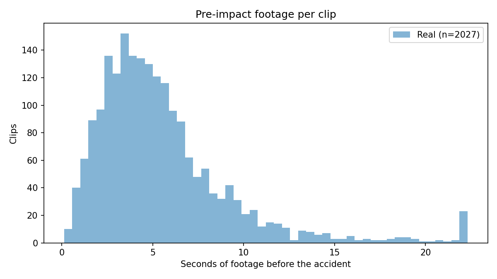

# Dataset audit — pre-impact footage and false-alarm budget

_Columns in metadata-real.csv: path, type, rollover, accident_time, accident_frame, center_x, center_y, x1, y1, x2, y2, region, scene_layout, weather, day_time, quality, no_frames, duration, height, width, split_in_distribution, split_geo_aware_

## Real (2027 clips)

- fps source: no_frames / duration
- Clips with an accident label: 2027 / 2027 -> clips with NO accident: 0

**Collision types**

| type | clips | share |
|---|---|---|
| single | 680 | 33.5% |
| t-bone | 657 | 32.4% |
| rear-end | 328 | 16.2% |
| sideswipe | 245 | 12.1% |
| head-on | 117 | 5.8% |

**weather**

| weather | clips |
|---|---|
| normal | 1651 |
| rain | 264 |
| snow | 112 |

**fps (rounded)**

| fps | clips |
|---|---|
| 15 | 808 |
| 30 | 229 |
| 25 | 134 |
| 8 | 117 |
| 14 | 100 |
| 20 | 73 |
| 10 | 51 |
| 13 | 51 |

**Timing**

- Duration (s): min 1.30 | median 26.83 | mean 21.85 | max 114.96
- Pre-impact (s): min 0.12 | median 4.67 | mean 5.57 | max 91.02
- Pre-impact (frames): min 2.00 | median 76.00 | mean 98.27 | max 954.00
- Post-impact (s): min 0.00 | median 19.70 | mean 16.28 | max 61.25

**Pre-impact frames per clip**

| bin | clips | share |
|---|---|---|
| <8 | 8 | 0.4% |
| 8-15 | 40 | 2.0% |
| 16-31 | 170 | 8.4% |
| 32-63 | 595 | 29.4% |
| >=64 | 1214 | 59.9% |

- Clips with fewer than 8 pre-impact frames: **8 (0.4%)**
- Clips that cannot fit one full 16-frame window before impact: **48 (2.4%)**
- At the model's 8 fps: fewer than 8 pre-impact frames: **46 (2.3%)**; fewer than 16: **215 (10.6%)**
- Clips with pre-impact <0.5 s: 7 (0.3%)
- Clips with pre-impact <1 s: 46 (2.3%)
- Clips with pre-impact <2 s: 215 (10.6%)

**Footage totals (for false alarms per hour)**

- Total pre-impact (normal) footage: **3.13 h** (188.0 min)
- Total post-impact footage: 9.17 h
- Full non-overlapping 16-frame normal windows: 11514

## Frozen real test subset (real_test_set.csv) (400 clips)

- fps source: no_frames / duration
- Clips with an accident label: 400 / 400 -> clips with NO accident: 0

**Collision types**

| type | clips | share |
|---|---|---|
| t-bone | 131 | 32.8% |
| single | 124 | 31.0% |
| rear-end | 73 | 18.2% |
| sideswipe | 49 | 12.2% |
| head-on | 23 | 5.8% |

**weather**

| weather | clips |
|---|---|
| normal | 331 |
| rain | 53 |
| snow | 16 |

**fps (rounded)**

| fps | clips |
|---|---|
| 15 | 169 |
| 30 | 52 |
| 25 | 25 |
| 14 | 22 |
| 8 | 16 |
| 29 | 12 |
| 23 | 11 |
| 20 | 10 |

**Timing**

- Duration (s): min 1.30 | median 28.33 | mean 22.05 | max 114.96
- Pre-impact (s): min 0.37 | median 4.75 | mean 5.97 | max 91.02
- Pre-impact (frames): min 6.00 | median 77.50 | mean 104.49 | max 954.00
- Post-impact (s): min 0.75 | median 19.18 | mean 16.08 | max 50.36

**Pre-impact frames per clip**

| bin | clips | share |
|---|---|---|
| <8 | 1 | 0.2% |
| 8-15 | 10 | 2.5% |
| 16-31 | 26 | 6.5% |
| 32-63 | 111 | 27.8% |
| >=64 | 252 | 63.0% |

- Clips with fewer than 8 pre-impact frames: **1 (0.2%)**
- Clips that cannot fit one full 16-frame window before impact: **11 (2.8%)**
- At the model's 8 fps: fewer than 8 pre-impact frames: **10 (2.5%)**; fewer than 16: **40 (10.0%)**
- Clips with pre-impact <0.5 s: 1 (0.2%)
- Clips with pre-impact <1 s: 10 (2.5%)
- Clips with pre-impact <2 s: 40 (10.0%)

**Footage totals (for false alarms per hour)**

- Total pre-impact (normal) footage: **0.66 h** (39.8 min)
- Total post-impact footage: 1.79 h
- Full non-overlapping 16-frame normal windows: 2430

